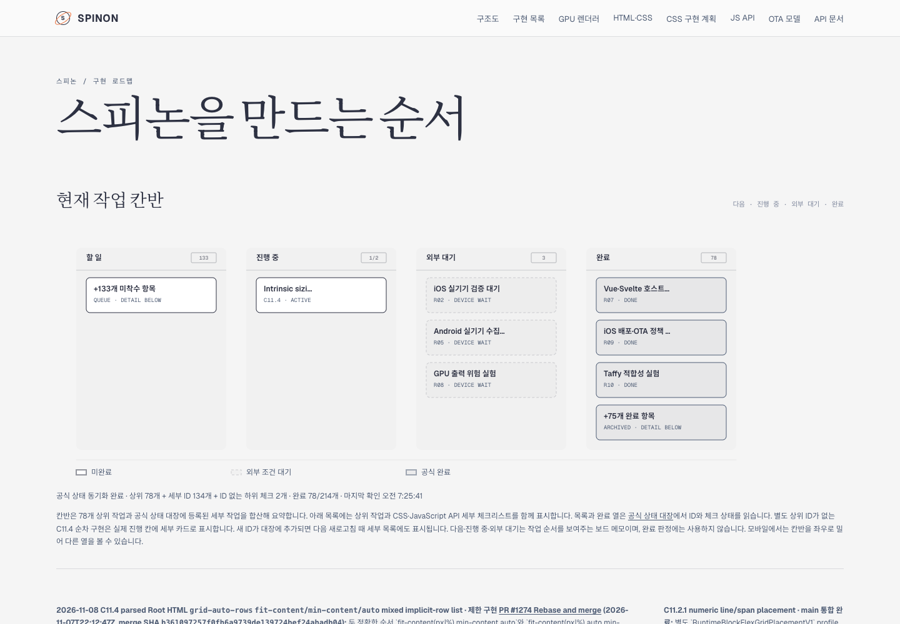
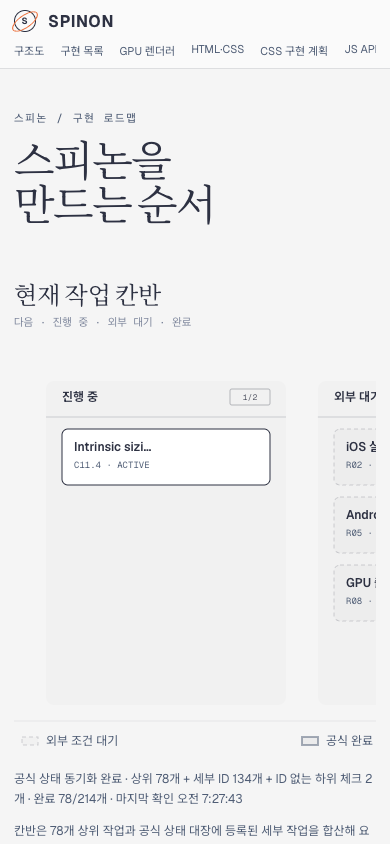

# PR #1274 이후 Tailnet 로드맵 동기화 · 2026-11-08

## 변경 이유와 표시

동기화 전 Tailnet 보드에는 `C11.4 · ACTIVE` 카드가 이미 있었지만 제목이 `Track sizing`으로만 보였고, 진행 기록은 PR #1272까지만 연결되어 있었다. 이번 갱신에서 진행 카드 제목을 `Intrinsic sizing`으로 구체화하고 최신 제한 구현 PR #1274, merge SHA, 검증 경계와 다음 순차 후보를 추가했다. 다음 후보는 `fit-content`·`min-content`·`auto` 세 member의 나머지 순서 조합이며, 아직 지원된 동작이나 구현 완료로 표시하지 않는다.

공식 완료 수 `78/214`와 C11.4/C11 미완료 판정은 바꾸지 않았다. 보드는 공식 상태 대장을 읽어 `완료 78/214`를 표시한다.

## Tailnet 동기화

Tailscale backend는 `Running`, Tailnet preview server는 PID `28040`으로 `127.0.0.1:8768`에서 실행 중이었다. `/Users/yoonhb/Library/Application Support/SpinonPreview/roadmap.html`은 일반 파일이고 교체 전 열린 file handle은 0개였다. 서버 재시작과 파일 삭제는 하지 않았다.

`spec/public/roadmap.html` working-tree source는 631,732 bytes, SHA-256 `855dbb7b93dafaeaed33340d6ccc7b9c0b346c00f5434daf33d8f2f9653160d4`다. Preview target은 같은 디렉터리 임시 파일을 쓰고 fsync 후 atomic rename으로 교체했다. 이전 629,981-byte 파일은 `/Users/yoonhb/Library/Application Support/SpinonPreviewBackups/roadmap-tailnet-sync-pr1274-c11-4-2026-11-08/pass01/roadmap.html`에 보관했고 이전 파일과 백업 SHA는 `5972620e626f3cf16b52d5d2335b029187c24b7b80244939036b87d6341d6e3b`로 같다.

로컬 HTTP와 Tailnet HTTPS는 모두 200을 반환했고 각각 631,732 bytes·source와 같은 SHA-256을 제공했다. Source hash, preview file, 두 HTTP body가 byte-identical이다. 상세 기록은 [preflight](./preflight.json), [백업·교체](./copy-and-backup.json), [제공본 검증](./served-verification.json), [동기화 script](./sync-tailnet-roadmap.mjs)에 있다.

Preflight 당시 source는 문서 PR의 working-tree candidate였다. `preflight.json`의 `sourceHead`는 변경 전 기준 HEAD를 가리키며, `source` SHA는 갱신된 working-tree 파일 bytes를 가리킨다. 둘의 시점을 혼동하지 않도록 `sourceSnapshotState`에 기록했다. 병합된 PR #1274 자체의 source SHA는 feature merge 기록이며 이 문서 동기화 PR의 merge SHA와 다르다.

## Agent Browser 확인

사용자가 지정한 Agent Browser로 Tailnet URL을 열어 렌더링된 상태를 확인했다.

- Desktop 1440×1000 CSS px: document/body width 1440px, 진행 열 `1/2`, `C11.4 · ACTIVE`, 완료 `78`이 보인다. [화면](./tailnet-roadmap-agent-browser-desktop.png) · [DOM 기록](./agent-browser-desktop.json)
- Mobile 390×844 CSS px: document/body width 390px로 페이지 가로 넘침이 없다. 보드 내부를 272px 밀어 진행 열을 표시했으며 `C11.4 · ACTIVE`와 `Intrinsic sizing` 카드가 보인다. [화면](./tailnet-roadmap-agent-browser-mobile.png) · [DOM 기록](./agent-browser-mobile.json)
- `spinon-roadmap-c114` 세션을 닫았고 `agent-browser session list`에 active session이 없으며 `pgrep -x agent-browser`도 프로세스를 찾지 못했다. [종료 기록](./agent-browser-lifecycle-final.json)

## 범위와 남은 한계

이번 동기화는 `/spinon/roadmap.html` 한 파일만 갱신했다. GitHub Pages/`gh-pages` 배포, 전체 사이트 재빌드, preview server 재시작은 하지 않았다. 모바일 보드는 열이 넓어서 보드 안에서 가로로 밀어 보는 UI이며 document 자체의 가로 넘침과 구분된다. PR #1274의 iOS Simulator 설치 전후 app-data container 연속성은 확인되지 않았고 원인은 특정되지 않았다.

검토 결과는 [PR diff 실패 관점 30개](./pr-diff-review-30.md), 파일 hash는 [SHA256SUMS.txt](./SHA256SUMS.txt)에 기록한다.
