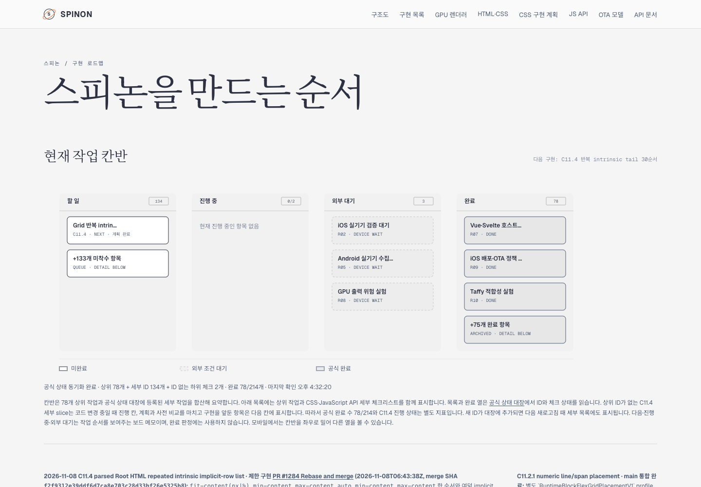
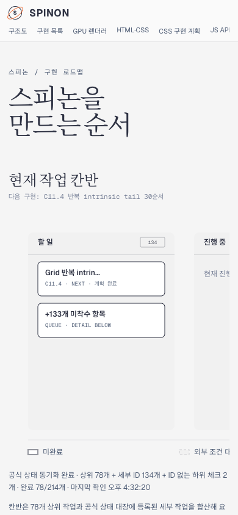

# C11.4 PR #1284 병합 후 roadmap 동기화

## 진행 중이 보이지 않았던 이유

Tailnet 페이지가 오래된 제공본을 보여 주고 있었다. 작업 전 Agent Browser에서 확인한 화면에는 이미 PR #1280으로 끝난 `Grid 24순서 구현`이 `진행 중`으로 남아 있었고, 병합된 PR #1284와 새 계획은 없었다. 처음 화면은 [`live-before-desktop.png`](./live-before-desktop.png)와 [`live-before-desktop.json`](./live-before-desktop.json)에 보존했다.

PR #1284는 `2026-11-08T06:43:38Z`에 Rebase and merge됐고 merge SHA는 `f2f9312e39ddf6d7ca8e703c28d33bf26e5325b8`이다. 다음 후보 `fit-content(px|%)` 뒤의 반복 intrinsic tail 30순서 계획은 끝났지만 제품 코드 구현은 아직 시작하지 않았다. 따라서 동기화된 보드에서는 이 후보가 `할 일`에 나오고 `진행 중 0/2`가 맞다. 이것은 C11.4 자체가 완료됐다는 뜻이 아니며 공식 C11.4/C11 체크와 완료 `78/214`는 그대로다.

## 게시와 제공본 검증

선택한 문서·증거 153개(16,034,765 bytes)를 게시했다. 57개는 추가, 79개는 기존과 동일, 17개는 사전 허용 목록에 따라 백업 후 같은 디렉터리에서 원자적으로 교체했다. 교체 대상의 열린 reader handle은 없었다. 게시 중 Tailnet preview PID 28040을 재시작하지 않았고 파일 삭제도 없었다. 자세한 값은 [preflight](./publication-preflight-pass02.json)·[게시 결과](./selected-publication-result-pass02.json)·[제공본 검증](./served-verification-pass02.json)에 있다.

로컬 preview와 Tailnet에서 16개 문서·이미지 경로 및 18개 생성 asset을 확인해 총 68개 HTTP·SHA-256 검사가 모두 통과했다. 전체 문서 dead-link 검사는 이번 범위에서 수행하지 않았다.

## Agent Browser 화면 확인

Tailnet roadmap 화면에서 desktop 1440×1000, mobile 390×844를 확인했다. 두 화면에서 다음 후보와 빈 진행 열이 구분되며, 공식 `78/214`도 보인다. 모바일 문서 자체의 `scrollWidth`는 viewport와 같은 390px이고 `할 일` lane 및 후보 카드가 첫 화면에 나타난다. 계획, 120/120 scene·9,480 checks 사전 비교 페이지, 비교 PNG(1440×2196)도 열렸다. [브라우저 검증 JSON](./agent-browser-verification-pass02.json).

### Desktop

### Mobile

검증을 마치고 `agent-browser close --all`로 세션을 닫았다. Agent Browser/Chrome 프로세스는 0개이며, Tailscale은 `Running`, Tailnet preview PID 28040과 tmux `spinon` 세션은 유지됐다. [프로세스 종료 확인](./agent-browser-lifecycle-pass02.json).

## 범위

이번 변경은 공식 상태 대장, 내부 Grid 계약, 계획, 공개 roadmap과 Tailnet 제공본을 동기화했다. 새로운 CSS Grid 제품 동작은 구현하지 않았고 C11.4 완료 수도 바꾸지 않았다. 다음 30순서 slice는 계획·사전 비교만 끝난 상태다.
