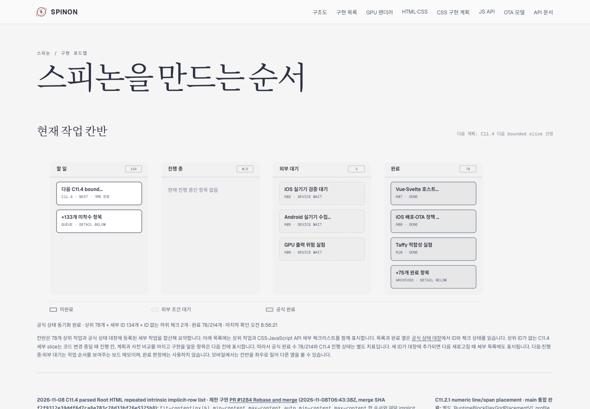
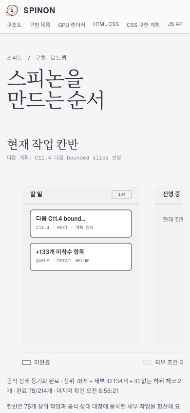
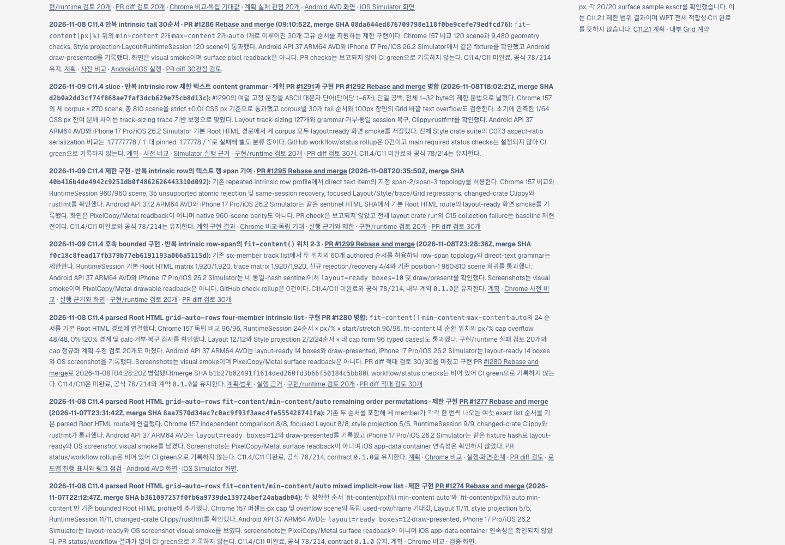
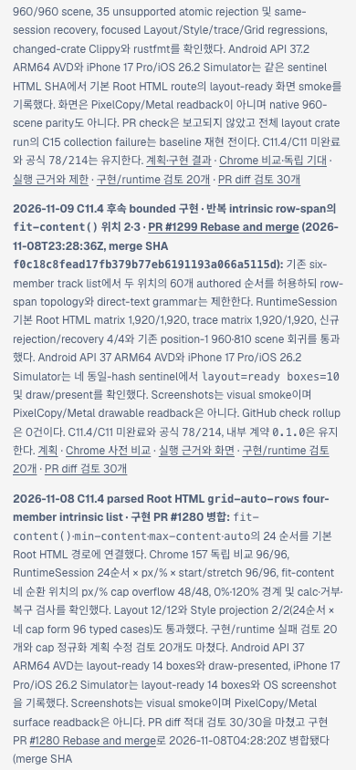

# C11.4 PR #1299 병합 후 상태·로드맵·Tailnet 동기화

이 기록은 구현 PR #1299 병합 결과를 상태 대장, 내부 계약, 계획, 공개 로드맵 원본과 사용자가 지정한 Tailnet 미리보기 경로에 맞춘다. 구현 코드와 공식 완료 수는 바꾸지 않는다.

## 병합된 구현과 공식 상태

- 구현 PR [#1299](https://github.com/ohah/spinon/pull/1299)은 `2026-11-08T23:28:36Z` Rebase and merge됐고 merge SHA는 `f0c18c8fead17fb379b77eb6191193a066a5115d`다.
- `spec/STATUS.md`, `spec/internal/0059-c11-grid-layout.md`, [계획](../../../../plan/c11-4-root-html-repeated-text-later-fit-content-row-span.md), [공개 로드맵 원본](../../../public/roadmap.html)과 [구현 근거](../c11-4-root-html-repeated-text-later-fit-content-row-span-implementation-2026-11-09/README.md)에 병합 정보를 반영했다.
- PR 상태 검사 rollup은 0건이다. GitHub CI가 통과했다고 기록하지 않는다. C11.4/C11 미완료, 공식 완료 `78/214`, 내부 계약 `0.1.0`을 유지한다.
- PR #1299는 여섯-member `grid-auto-rows`에서 `fit-content()` 위치 2·3을 제한 허용한 slice다. 기본·trace RuntimeSession matrix는 각각 1,920/1,920이며 Android/iOS 화면은 visual smoke다. PixelCopy·Metal drawable readback이나 일반 CSS/Grid 지원으로 확대 해석하지 않는다.

## Tailnet 제공본

게시 전 Tailscale은 `Running`, 기존 미리보기 서버 PID는 `28040`이고 `127.0.0.1:8768`에서 수신 중이었다. pass01은 87개 경로(15,399,168 bytes) 가운데 58개 생성, 11개 백업 후 교체, 18개 동일 hash를 기록했다. 브라우저 증거를 포함한 pass02는 103개 경로(18,023,335 bytes) 가운데 39개 생성, 22개 백업 후 교체, 42개 동일 hash를 반영했다. PR 카드에서 동기화 근거로 가는 링크를 보탠 pass03은 113개 경로(18,368,235 bytes) 가운데 33개 생성, 25개 백업 후 교체, 55개 동일 hash를 기록했다. 세 pass 모두 교체 경로 열린 파일은 0개였고, pass02와 pass03의 로컬·HTTPS SHA 검증은 각각 103/103, 113/113이다. 서버 재시작이나 경로 삭제는 없었다. 최종 pass03 route별 결과는 [선택 root](./selected-root-pass03.json) · [route/hash manifest](./selected-publication-pass03.json) · [게시 전 검사](./preflight-pass03.json) · [백업·복사](./copy-and-backup-pass03.json) · [제공본 검사](./served-verification-pass03.json)에 보존한다.

선택한 문서 빌드의 재현 설정은 [`rspress.config.ts`](./rspress.config.ts)이며 pass01/pass02/pass03 실행 로그는 각각 `selected-build.log`, `selected-build-pass02.log`, `selected-build-pass03.log`다. dead-link/dead-image 검사는 이번 선택 빌드에서만 비활성화했다. 저장소 기본 전체 문서 build가 통과했다고 주장하지 않는다. 전체 build는 기존 `rust,ignore` 언어 표식과 누락된 기존 이미지에서 실패했다. 해당 pass 로그 `full-build-excluded-errors.log`는 원인 분류를 위해 보존한다.

## 화면 확인과 프로세스 정리

Tailnet 페이지를 Agent Browser `0.31.1` / Chrome `157.0.8103.39`에서 열었다. Desktop `1440×1000`에서 PR #1299 병합 시각·SHA, 다음 C11.4 queue와 공식 `78/214`를 확인했고 `documentElement.scrollWidth=1440`이었다. Mobile `390×844`에서도 같은 카드를 확인했으며 문서와 body 폭이 모두 390px이었다. 내부 가로 스크롤은 상단 메뉴(479px), 칸반(1,120px), 구조도(720px)에만 있었다. [Desktop 보드](./tailnet-roadmap-agent-browser-desktop.png) · [Mobile 보드](./tailnet-roadmap-agent-browser-mobile.png) · [Desktop 병합 카드](./tailnet-roadmap-agent-browser-desktop-progress.png) · [Mobile 병합 카드](./tailnet-roadmap-agent-browser-mobile-progress.png).

화면 확인에 사용한 `spinon-roadmap1299-verify` 세션과 그 Chrome 프로세스 tree를 종료했다. 이후 session info는 `active=false`, pid는 `null`이고, 이번 실행에서 시작한 PID 53793과 Chrome PID 53802는 남아 있지 않다. 별도 프로젝트에서 이미 떠 있던 브라우저는 건드리지 않았다. [`agent-browser-verification.json`](./agent-browser-verification.json)과 [`agent-browser-lifecycle.json`](./agent-browser-lifecycle.json)에 관측값과 종료 상태를 기록했다.

### Agent Browser 캡처

## 문서 PR

문서 변경 PR의 서로 다른 실패 관점 검토는 [`pr-diff-review-30.md`](./pr-diff-review-30.md)에 기록한다. 구현 PR #1299의 status-check rollup이 비어 있다는 사실과 문서 미리보기의 시각 검증은 별도 근거로 유지한다.
