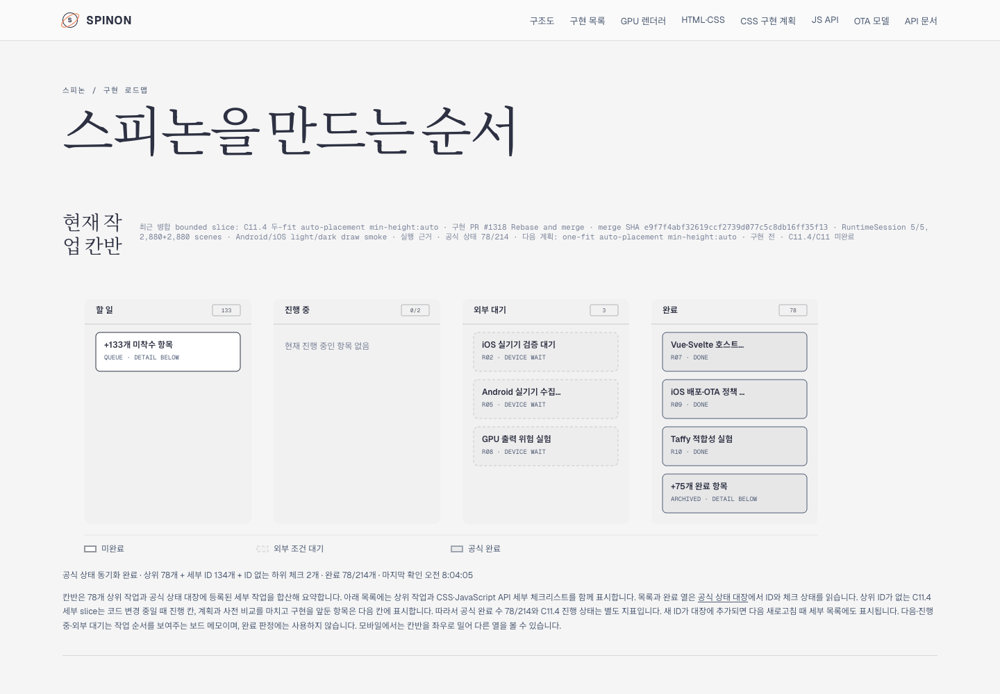
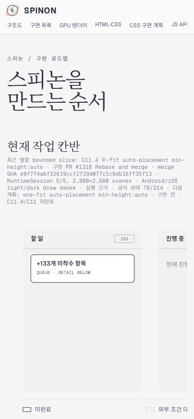
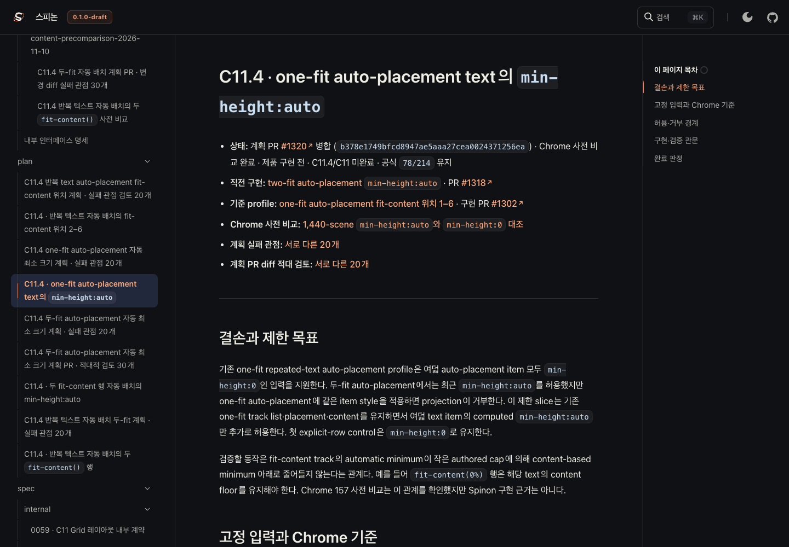
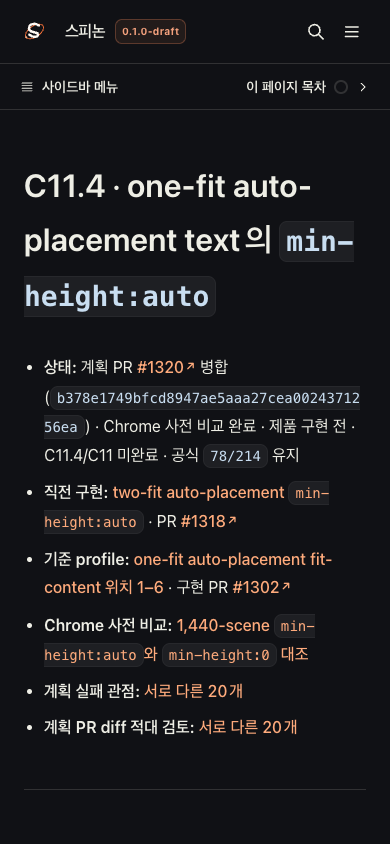

# Tailnet roadmap sync after plan PR #1320

**Source:** `6003e286f7bb5d36b3715a7836f4c358943bf229` (`bab0356fcdd6db08977845291655786d7a5b3d89`)
**Plan PR:** [#1320](https://github.com/ohah/spinon/pull/1320), merged at `b378e1749bfcd8947ae5aaa27cea0024371256ea`
**Scope:** publish the selected roadmap, status, C11 plans, and evidence routes to the existing Tailnet preview. Preserve the existing index and 404 pages; remove no served routes.

The selected RSPress 2.0.22 build contains 93 selected source files and 203 generated/source routes (28,013,670 bytes). The plan header now reports the actual #1320 merge state. The public status remains `78/214`; C11 and C11.4 remain incomplete, and the contract stays at `0.1.0`.

## Sync evidence

- `preflight.json`: Tailscale backend running; expected preview server PID `90711`; 103 routes to create, 40 to replace, 60 already identical; no changed route had an open handle.
- `copy-and-backup.json`: 103 created and 40 replaced; all 40 replaced files backed up under `~/Library/Application Support/SpinonPreviewBackups/roadmap-tailnet-sync-pr1320-c11-4-2026-11-10/pass01`.
- `served-verification.json`: all 203 local routes matched the selected publication hashes; all 203 HTTPS routes returned HTTP 200 and matched hashes; all 40 backups matched their recorded prior hashes.
- The existing preview server was not restarted. The sync made no deletes.
- The previous failed build and its manifests were removed before the corrected pass. After publication and browser verification, the final task build subtree was also removed after confirming there were no open handles; its selected-root/publication manifests and sync reports remain as evidence.

## Agent Browser verification

Agent Browser 0.31.1 with HeadlessChrome 157 verified the Tailnet roadmap at 1440×1000 and 390×844, the new plan page at both viewport sizes, and the plan/evidence link targets. At 390px, the document width stayed at 390px. The evidence README's sample PNG link opened the intended Tailnet path and loaded completely at 1280×900. The browser session was closed; lifecycle details are in `agent-browser-lifecycle.json` and page observations are in `agent-browser-verification.json`.

### Roadmap

### One-fit auto-minimum plan

## Reproduction

From the repository root, run `prepare-selected-root.mjs`, then from `packages/docs` run the RSPress build with `rspress.config.ts` and `SPINON_DOC_PASS=pass01`, then run `stage-publication.mjs`. `sync-tailnet.mjs preflight`, `copy`, and `verify` reproduce the guarded sync; copy refuses to proceed unless source hashes, target state, backups, and open-handle checks match the saved preflight.

The preview host is `https://macstudio.tailed42f2.ts.net/spinon/roadmap.html`. The server's separate root is `~/Library/Application Support/SpinonPreview`; this run updated selected routes only.
