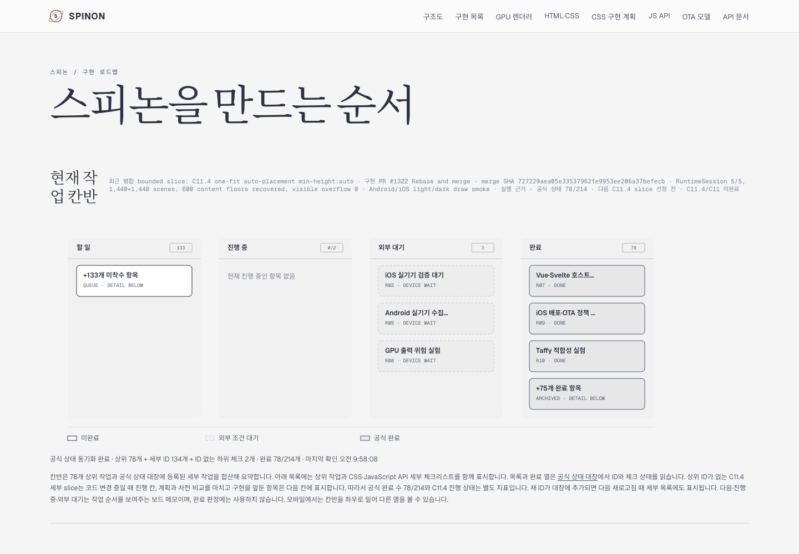
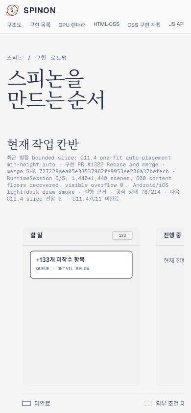

# Tailnet roadmap sync after implementation PR #1322

**Source slice:** C11.4 one-fit repeated-text auto-placement `min-height:auto`.
**Implementation PR:** [#1322](https://github.com/ohah/spinon/pull/1322), merged by Rebase and merge at `2026-11-10T00:37:12Z`; merge SHA `727229aea05e33537962fe9953ee206a37befecb`.
**Selected documentation source:** commit `730066df57c72076b061644a78aa05b6b0047dd0`, clean tracked tree `5afbf8767992b45c522fd749066860267ad804c8`.
**Scope:** synchronize the updated public roadmap, official status, internal Grid contract, implementation plan, and selected evidence routes to the existing Tailnet preview. Preserve its index and 404 routes; delete no served route.

The official completion count stays `78/214`; C11.4 and C11 remain incomplete; internal numeric contract version stays `0.1.0`. PR #1322 had zero checks, so this sync does not claim CI success.

## Publication evidence

- [`pr-diff-review-20.md`](./pr-diff-review-20.md) records twenty distinct adverse checks for this docs-only PR.
- `selected-root-pass04.json` and `selected-publication-pass04.json` bind the selected documents and generated pages to the source commit and SHA-256 values.
- RSPress 2.0.22 generated 203 selected routes (28,064,787 bytes) from 93 selected source files (13,456,345 bytes). The selected roadmap card's three local links resolve to staged publication routes; this is not a full-docs dead-link claim.
- `preflight-pass04.json` checks the running Tailscale backend and records the existing preview listener as PID 90711. It found 50 new routes, 48 replacements, 105 already-identical routes, and zero open handles on files scheduled for replacement.
- `copy-and-backup-pass04.json` records 50 created and 48 replaced routes. All 48 previous files were saved under `~/Library/Application Support/SpinonPreviewBackups/roadmap-tailnet-sync-pr1322-c11-4-2026-11-10/pass04` before replacement.
- `served-verification-pass04.json` confirms local and HTTPS HTTP 200/hash matches for all 203 routes and SHA-256 matches for all 48 backups.
- `agent-browser-verification.json` and `agent-browser-lifecycle.json` record the final desktop/mobile inspection and session closure. The captured page shows PR #1322, its merge SHA, and the unchanged `78/214` count.
- `SHA256SUMS` covers the 15 evidence files and verifies with `shasum -a 256 -c` from this directory.
- The preview server was not restarted; no served route was deleted.

## Agent Browser captures

Agent Browser 0.31.1 is used for the live preview. No Terminal Browser is used. The named session is inactive after inspection; an older unrelated Terminal Browser process in `hwpjs` was left untouched.

### Roadmap · desktop

### Roadmap · mobile

## Reproduction and cleanup

From the repository root, run `prepare-selected-root.mjs pass04`, run the selected RSPress 2.0.22 build using `rspress.config.ts` with `SPINON_DOC_PASS=pass04`, then run `stage-publication.mjs pass04`. Run `sync-tailnet.mjs preflight pass04`, `copy pass04`, and `verify pass04` in order. The copy step checks the recorded source/target hashes and open handles, preserves replaced content in the task-specific backup folder, and creates no deletes.

The generated passes are isolated under `build/spinon/roadmap-tailnet-sync-pr1322-c11-4-2026-11-10/`. After browser verification, remove only that exact task-owned tree once `lsof` confirms that no process has any of its files open. Keep the selected manifests, reports, and screenshots in this evidence directory. Preserve shared simulator profiles and prior evidence snapshots.

Preview URL: <https://macstudio.tailed42f2.ts.net/spinon/roadmap.html>

Preview root: `~/Library/Application Support/SpinonPreview`

Existing listener: TCP 8768, `tailnet-preview-server.mjs`.
