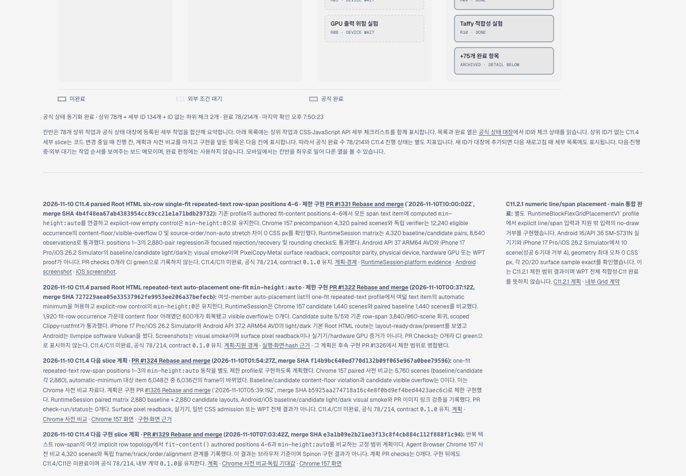
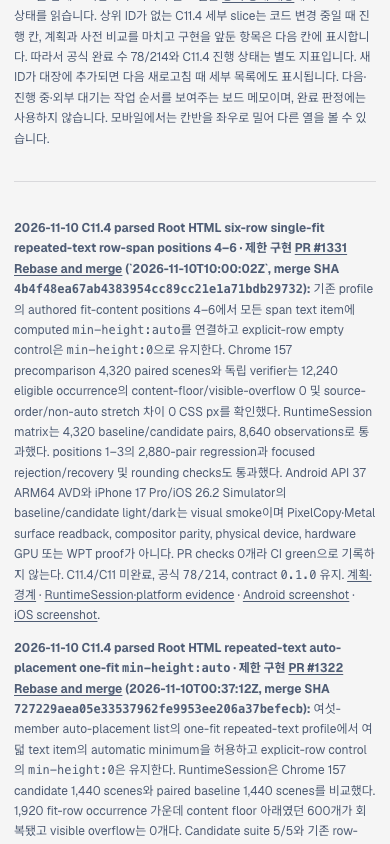

# PR #1332 병합 뒤 Tailnet 로드맵 동기화

PR [#1332](https://github.com/ohah/spinon/pull/1332)의 문서 변경을 `https://macstudio.tailed42f2.ts.net/spinon/roadmap.html` 미리보기에 반영했다. GitHub `main`과 공개 로드맵의 구현 상태는 기존 값인 `78/214`, C11.4/C11 미완료, 내부 숫자 계약 `0.1.0`을 유지한다. 이 작업은 상태 집계나 제품 코드를 변경하지 않는다.

## 입력과 선택 빌드

- 원본 문서 commit `41e391117a76d3a6db8329adf89bddf64f281367`, tree `f626ac9f68d045b4d9bf833c0208bbb0c06bbbe4`다. PR #1332는 `2026-11-10T10:35:42Z` Rebase and merge됐다.
- 선택 입력은 roadmap, `STATUS.md`, conformance, 내부 계약 0059, C11.4 계획·검토, 사전 비교와 RuntimeSession evidence다. 선택 root는 일반 파일 155개, 46,128,054 bytes를 포함하며 source symlink는 0이다.
- 저장소 설치본 `@rspress/core` 2.0.22로 선택 문서 build를 완료했다. 출력은 220 route, 59,120,197 bytes다. 전체 문서 dead-link 검사는 꺼져 있어 전체 문서 build나 전체 링크 유효성을 주장하지 않는다.
- 첫 도움말 조회에서 루트 `bunx rspress`는 저장소 pin과 다른 1.47.2를 해석했지만 실제 build에는 사용하지 않았다. 고정 CLI의 첫 build는 README 상대 PNG import 해석 오류로 실패했다. 선택 build 전용 `resolve.preferRelative` 설정을 추가한 뒤 2.0.22 build가 성공했다. 두 번째 build 로그에는 성공 산출물 목록이 있다.
- CLI 로그의 표 출력 정렬 공백과 끝의 빈 줄은 `git diff --check`에 맞춰 정규화했다. 메시지와 오류 내용은 보존했다.
- 게시 경로 검사에서 처음에는 #1331 문단 내부 링크 수를 3개로 잘못 예상했다. 실제 두 내부 링크와 계약 문서의 `[#1331]` Markdown 링크 표현에 맞게 검사를 고친 뒤 publication 생성이 통과했다. 원본 문서는 수정하지 않았다.

관련 근거: [선택 root manifest](./selected-root.json), [publication manifest](./selected-publication.json), [Rspress 성공 로그](./selected-build-pass02.log), [초기 상대 이미지 진단 로그](./selected-build-pass01-relative-image-failure.log).

## 미리보기 제공 확인

사전 점검은 Tailscale backend `Running`, 지정 preview 서버 PID `90711`, 로컬 HTTP 200을 확인했다. 대상 교체 파일에는 열린 file handle이 없었다. preview 서버는 재시작하지 않았다.

- 220개 route 중 147개 생성, 27개 교체, 46개 동일 hash였다. 기존 파일 27개는 `~/Library/Application Support/SpinonPreviewBackups/roadmap-tailnet-sync-pr1332-c11-4-2026-11-10/pass01`에 경로·hash를 보존했다.
- 로컬 preview hash와 Tailnet HTTPS HTTP 200/hash는 각각 220/220, rollback backup 검증은 27/27이다.
- route 삭제는 없었다. 기존 `index.html`과 `404.html`은 publication 교체 대상에서 제외했다.

상세 기록: [preflight](./preflight.json), [copy 및 backup](./copy-and-backup.json), [local·HTTPS 확인](./served-verification.json).

## Agent Browser 화면 확인

Agent Browser 0.31.1로 지정 Tailnet 주소를 열었다. 데스크톱 `1440×1000`과 모바일 `390×844` 모두 문서 폭과 body 폭이 viewport와 같았다. 화면 본문에서 merge SHA, `78/214`, C11.4/C11 미완료를 확인했고 browser error는 보고되지 않았다.

연결된 RuntimeSession evidence README도 모바일 viewport `390px`에서 열었다. 문서/body 폭은 모두 390px이고 로고 외 후보 화면 4개가 모두 로드됐다. iOS 원본은 각각 1206×2622, Android AVD 원본은 각각 1080×2400이며 화면 안에 맞춰 표시됐다. 브라우저 세션을 종료한 뒤 active session이 없음을 확인했다. 구조화 측정은 [Agent Browser 확인 기록](./agent-browser-verification.json)에 있다.

## 정리와 남은 범위

- 이번 동기화를 위해 생성한 `build/spinon/roadmap-tailnet-sync-pr1332-c11-4-2026-11-10`은 제공 hash 확인을 마치고 open handle이 없음을 확인한 뒤 제거했다. 재생성 가능한 46 MB 선택 입력과 59 MB publication은 계속 보관하지 않는다.
- 이전 제공본 rollback backup은 복구에 필요할 수 있어 보존했다. 다른 작업의 미추적 저장소 산출물은 건드리지 않았다.
- 부팅된 iOS Simulator, Simulator.app, ADB 기기, Android emulator process는 없었다. `S03` profile은 inventory에 없었다. C11에서 사용한 공유 iOS profile과 Android API 37 AVD 데이터는 후속 검증에서 재사용할 수 있어 보존했다.
- 이미지와 화면 확인은 Agent Browser desktop/mobile 증거다. 전체 문서 dead-link 검사, iOS/Android 앱 재실행, 실기기 검증은 이 동기화에서 수행하지 않았다.
