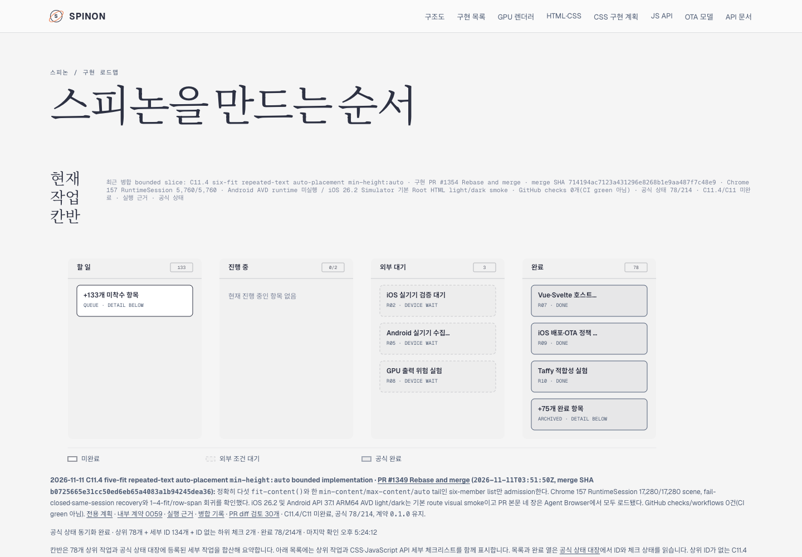
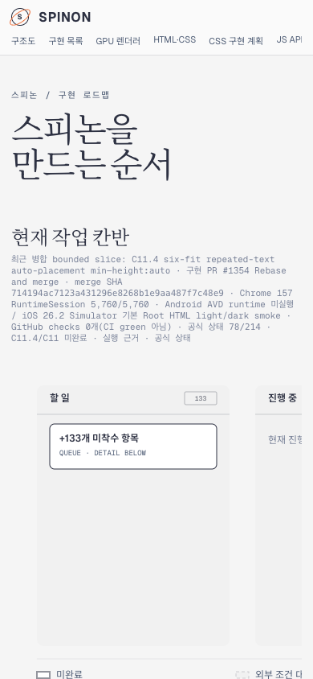

# PR #1354 이후 Tailnet 로드맵 동기화 · 2026-11-11

구현 PR [#1354](https://github.com/ohah/spinon/pull/1354)은 `2026-11-11T07:55:23Z` Rebase and merge됐고 merge SHA는 `714194ac7123a431296e8268b1e9aa487f7c48e9`다. C11.4/C11은 미완료이며 공식 완료 `78/214`와 internal numeric contract `0.1.0`은 유지한다.

## 갱신 범위와 제공본

사용자가 지정한 [Tailnet roadmap](https://macstudio.tailed42f2.ts.net/spinon/roadmap.html)은 RSPress 산출물이 아니라 `spec/public/roadmap.html` 단일 파일을 제공한다. 함께 갱신한 문서 제공본은 `spec/STATUS.md`, 내부 계약 0059, six-fit 계획 및 six-fit runtime evidence의 Markdown·RSPress HTML이다. 전체 RSPress 사이트나 GitHub Pages는 배포하지 않았다.

미리보기 서버 PID `90711`은 `/Users/yoonhb/Library/Application Support/SpinonPreview`를 `127.0.0.1:8768`에서 제공한다. 교체 전에 있던 `roadmap.html`, `STATUS.md/html`, `internal/0059-c11-grid-layout.md/html` 다섯 파일의 backup을 `backup/roadmap-tailnet-sync-pr1354-c11-4-sixfit-2026-11-11/`에 보존했다. plan과 evidence page는 이전 preview에 없어서 추가했다. 기존 파일은 삭제하지 않았고 서버도 재시작하지 않았다.

## Source와 제공본 hash

`/spinon/roadmap.html`은 `670,727` bytes, SHA-256 `7f7e118e3ce44699c1703c67c507b709ff6f1adf74bfd60ee92e8582c6fad9ab`다. Repository source, preview 파일, local HTTP와 Tailnet HTTPS 응답이 byte-identical이다. 상태 Markdown, 내부 계약 0059, six-fit 계획 및 실행 근거 Markdown·HTML도 각 source/preview/local HTTP/Tailnet HTTP의 byte count와 SHA-256이 일치하고 HTTP 200을 반환했다. [파일별 검증 기록](./served-verification.json)과 [evidence artifact checksums](./SHA256SUMS)을 참조한다.

## Agent Browser 확인

전용 session `spinon-c114-pr1354-roadmap`에서 Tailnet URL을 열었다. Desktop 1440×1000 CSS px와 mobile 390×844 CSS px 모두 document/body width가 viewport와 같고 horizontal overflow가 없다. 두 화면에서 PR #1354, merge SHA, `78/214`, C11.4/C11 미완료, six-fit 720 authored order를 확인했다. 결과는 [desktop geometry](./agent-browser-verification-desktop.json), [mobile geometry](./agent-browser-verification-mobile.json), [desktop screenshot](./tailnet-roadmap-agent-browser-desktop.png), [mobile screenshot](./tailnet-roadmap-agent-browser-mobile.png)에 기록했다. 기존 HWP Agent Browser session은 보존한다.

같은 Tailnet에서 갱신한 [공식 상태 페이지](https://macstudio.tailed42f2.ts.net/spinon/STATUS.html)와 [C11 Grid 계약](https://macstudio.tailed42f2.ts.net/spinon/internal/0059-c11-grid-layout.html)도 Agent Browser로 열어 PR/merge 정보와 `78/214`, 미완료 경계, `0.1.0`, six-fit matrix 링크를 확인했다. 로드된 두 문서의 결과는 [STATUS](./status-agent-browser-verification.json)와 [0059](./contract-agent-browser-verification.json)에 기록한다.

Tailnet roadmap desktop/mobile PNG를 문서 PR [#1355](https://github.com/ohah/spinon/pull/1355)의 본문에 넣었다. GitHub PR page를 Agent Browser로 열어 image `complete=true`와 intrinsic size 1440×1000, 390×844를 확인한 기록은 [PR image verification](./pr-image-agent-browser-verification.json)이다.

이 문서 변경 자체의 서로 다른 failure path 검토는 [PR diff review](./pr-diff-review-30.md)에 있다.

전용 session 종료 확인은 [lifecycle record](./agent-browser-lifecycle-final.json)에 있다. 해당 session은 inactive/`pid:null`이고 프로세스가 없다. 기존 HWP Agent Browser session은 PID 70988로 계속 활성 상태라 보존했다.

## 한계

이 작업은 Tailnet 개발 미리보기의 선택 문서 파일을 갱신한다. 공식 완료 수를 변경하거나, 전체 사이트 build/deploy 또는 GitHub Pages 배포를 뜻하지 않는다. 분리 RSPress build에서는 이번 경로에 포함되지 않은 기존 문서의 dead-link 검사를 끈다. 변경한 페이지와 필요한 새 assets만 기존 preview tree에 덮어썼고, 기존 파일을 정리하거나 삭제하지 않았다.
