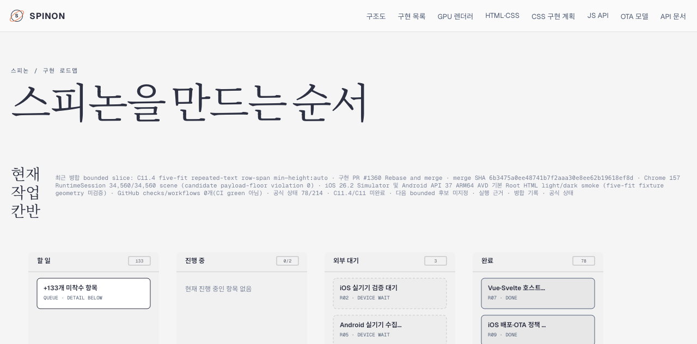

# PR #1361 병합 후 Tailnet 문서 미리보기 동기화

2026-11-12 KST에 PR [#1361](https://github.com/ohah/spinon/pull/1361)이 병합된 source를 사용해 사용자가 정한 Tailnet 문서 미리보기를 갱신했다. 이 동기화는 정적 문서 산출물에 한정되며, GitHub Pages 배포나 앱 runtime/시뮬레이터 검증을 수행하지 않았다.

## Source와 빌드 경계

- source commit: `459783407f043265b350030e9ebc49bfb4651a1d`; source tree: `754e4fe183f37a1ef2dc27da434d5359e4fa397f`
- merge 이후 checkout tree도 `754e4fe183f37a1ef2dc27da434d5359e4fa397f`로 source tree와 일치했다.
- 선택 root는 67 tracked files, 7,796,436 bytes, symlink 0개다. 세부 source별 SHA-256은 [selected-root.json](./selected-root.json)에 있다.
- 전체 `mise exec -- bun run docs:build` 시도는 이번 변경과 관계없는 기존 문서의 dead link 검사에서 실패했다. 오류를 숨겨 전체 검증 성공으로 취급하지 않았다.
- 선택한 `spec/` root를 대상으로 한 RSPress 2.0.22 빌드는 성공했다. 이 제한 빌드는 작업별 config에서 generic dead-link/image 검사를 끈다. 따라서 전체 docs link validation 결과는 `false`로 남겼다.
- 제한 빌드 산출물과 공개 경로 매핑은 [selected-publication.json](./selected-publication.json)에 기록했다. 138 routes, 총 22,763,944 bytes이며 삭제 경로는 없다.

## Tailnet 대상과 백업

미리보기 서버 PID `90711` (`127.0.0.1:8768`)와 기존 preview root를 유지했다. 사전 목록 및 복사 후 해시 확인은 [preflight.json](./preflight.json), [copy-and-backup.json](./copy-and-backup.json)에 있다.

- source 경로 수: 138; 생성 94, 교체 31, 동일 13, 삭제 0
- 교체 전 기존 파일 31개, 10,283,318 bytes를 전용 backup 경로에 복사하고 SHA-256을 확인했다.
- 138개 source/target hash와 31개 backup hash가 모두 일치한다.
- 첫 복사 시도는 전용 backup 하위 폴더가 없어 사전 확인 단계에서 중단됐다. target 파일은 변경되지 않았고 backup parent를 만든 뒤 두 번째 시도를 완료했다.
- Tailnet HTTPS에서 138개 route 모두 HTTP 200을 반환했고 본문 hash가 source와 일치한다. 상세값은 [served-verification.json](./served-verification.json)에 있다.

## Agent Browser 확인

Agent Browser로 [Tailnet roadmap](https://macstudio.tailed42f2.ts.net/spinon/roadmap.html)을 열었다. 표시된 최근 병합 PR #1360 및 merge SHA, RuntimeSession 34,560/34,560, 공식 상태 78/214, C11.4/C11 미완료, 다음 bounded 후보 미지정, 현재 칸반 0/2를 확인했다. C11.4는 최근 병합 요약에 나타나며 현재 진행중 항목으로 표시되지 않는다.

캡처는 1280×633 PNG, 89,601 bytes, SHA-256 `85ec6f6063c17cc5789aba66c0eec6f5128bf209be930cc807f5f2fd56928b68`다. URL/DOM 확인은 [agent-browser-verification.json](./agent-browser-verification.json), 세션 종료 기록은 [agent-browser-lifecycle.json](./agent-browser-lifecycle.json)에 있다. 검증 후 Agent Browser 세션을 닫았고 실행 파일 프로세스가 남지 않았다. Terminal Browser와 사용자 소유 브라우저 세션은 건드리지 않았다.

## 보존 범위와 한계

- 동기화 직전 파일은 `/Users/yoonhb/Library/Application Support/SpinonPreviewBackups/roadmap-tailnet-sync-pr1361-2026-11-12/pass01/`에 남겨 롤백 근거로 보존했다.
- 이 근거 PR은 이미 병합된 PR #1361의 Tailnet 반영 기록만 추가한다. 공식 상태나 구현 완료 수를 바꾸지 않는다.
- GitHub Pages workflow는 실행하지 않았다. 전체 문서의 기존 dead link는 이번 범위에서 수정하지 않았다.
