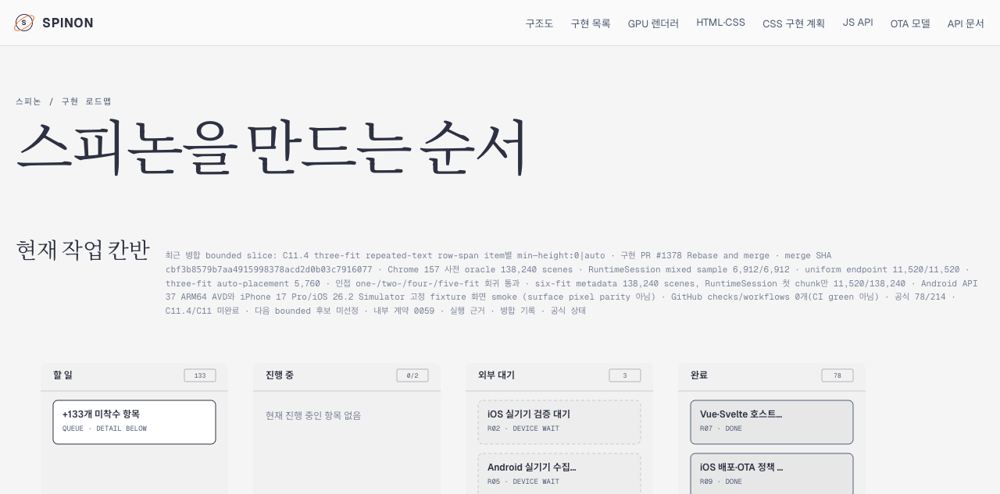

# PR #1378 병합 후 Tailnet 로드맵 동기화 · 2026-11-14

## 기준과 범위

- 구현 PR: [#1378](https://github.com/ohah/spinon/pull/1378), 2026-11-13T19:42:09Z Rebase and merge
- merge SHA: `cbf3b8579b7aa4915998378acd2d0b03c7916077`
- 미리보기: <https://macstudio.tailed42f2.ts.net/spinon/roadmap.html>
- 공식 구현 수 `78/214`, C11.4/C11 미완료, 다음 bounded slice 미선정
- GitHub Pages는 배포하지 않았다. 이 동기화는 Tailnet 미리보기만 갱신했다.

세 fit mixed row-span의 Chrome oracle 138,240 scenes, RuntimeSession sample 6,912/6,912 및 실제 플랫폼 화면 smoke를 병합 결과로 반영했다. six-fit RuntimeSession은 전체 138,240 scenes가 아니라 첫 11,520-scene chunk만 실행됐다. Android/iOS 화면은 surface pixel parity 증거가 아니며 PR check/workflow rollup도 비어 있었다. 로드맵 칸반에는 선택된 후속 세부 작업이 없으므로 `진행 중 0/2`로 표시된다. 상위 C11.4는 미완료 상태다.

## Tailnet 파일 동기화

Tailnet backend는 `Running`이었고 기존 preview server가 `127.0.0.1:8768`에서 HTTP 200을 반환했다. PID 90711은 그대로 유지했으며 서버를 재시작하지 않았다. 동기화는 Git index의 추적 파일과 이 작업에서 만든 merge record만 선택했다. 다른 미추적 workspace 산출물은 포함하지 않았다.

- Rspress `2.0.22` 빌드 입력: 173 files / 17,264,187 bytes
- 선택된 publication: 215 routes / 28,413,517 bytes
- Tailnet 대상: 새 파일 158개, 교체 18개, 동일 39개
- 교체 전 백업 hash: 18/18 일치
- HTTPS에서 제공된 route: 215/215 HTTP 200 및 local byte/hash 일치
- 삭제: 0개; preview server 재시작: 0회
- 최신 로드맵 요약의 local link 5개 모두 publication에 포함했다.

[선택 root](./selected-root-pass02.json) · [publication manifest](./selected-publication-pass02.json) · [preflight](./preflight-pass02.json) · [copy/backup](./copy-and-backup-pass02.json) · [HTTPS 제공 hash](./served-verification-pass02.json).

검토용 manifest와 로그에서는 사용자 홈 및 workspace 절대 경로를 가렸다.

최초 staging 시 선택 root에 icon asset이 없어 Rspress build가 실패했다. 실패 로그와 manifest는 보존했고, 선택한 SVG를 root에 더해 Rspress 2.0.22로 다시 빌드했다. [실패 로그](./selected-build-fail01.log) · [성공한 build](./selected-build-pass02.log).

## Agent Browser 확인

Agent Browser 0.31.1에서 로드맵 제목, PR #1378과 merge SHA, 공식 `78/214`, C11.4 미완료 상태를 확인했다. 병합된 [계획](https://macstudio.tailed42f2.ts.net/spinon/plan/c11-4-root-html-repeated-text-row-span-three-fit-mixed-auto-minimum.html), [실행 근거](https://macstudio.tailed42f2.ts.net/spinon/internal/evidence/c11-4-root-html-repeated-text-row-span-three-fit-mixed-auto-minimum-runtime-2026-11-14/README.html), [병합 기록](https://macstudio.tailed42f2.ts.net/spinon/internal/evidence/c11-4-root-html-repeated-text-row-span-three-fit-mixed-auto-minimum-runtime-2026-11-14/merge-PR1378.html) route도 열어 확인했다.

[Agent Browser 결과](./agent-browser-verification-pass02.json) · [세션 종료 확인](./agent-browser-lifecycle-pass02.json). 확인에 쓴 Agent Browser 세션과 세션 프로세스는 종료했다.

## 검토와 한계

- [문서 변경 검토 30개](./pr-diff-review-30.md)
- 링크 검사는 현재 로드맵 bounded slice의 다섯 local route와 위에서 연 계획·실행 근거·병합 기록을 대상으로 했다. 전체 문서 사이트 링크 검사는 수행하지 않았다.
- 이 작업은 문서 미리보기 갱신이다. 앱 runtime을 재실행하거나 PR #1378의 검증 범위를 확장하지 않는다.
