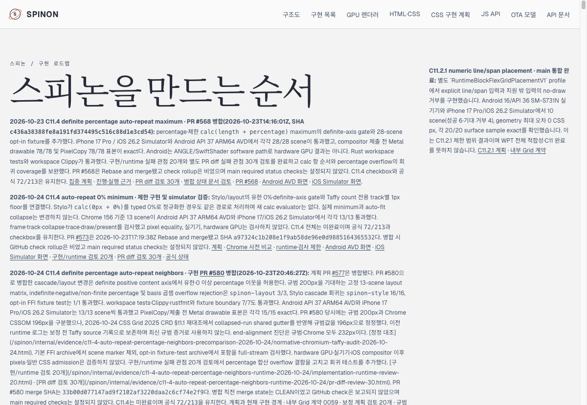
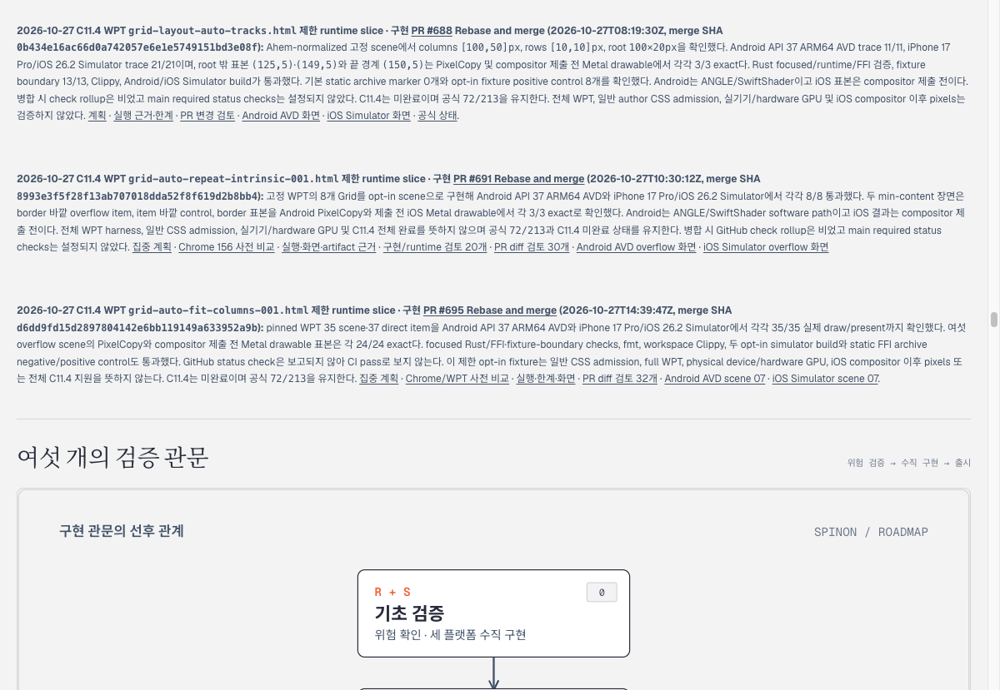

# PR #696 병합 후 Tailnet roadmap 단일 경로 동기화

2026-10-27에 PR [#696](https://github.com/ohah/spinon/pull/696) 병합 뒤, 병합된 `spec/public/roadmap.html` 한 파일을 Tailnet 미리보기의 roadmap 경로에 반영했다. 이 작업은 문서 사이트 전체 빌드·배포가 아니다.

## 출처와 교체

- 출처는 `origin/main`의 merge SHA `d019db91d9f592af99d9cfed22bcd1b1600f1445`다. `spec/public/roadmap.html`은 347,943 bytes, SHA-256 `7f8091cb06785e7c93c4c86fe17c2156a904251c7e01b24e8fe9599dc654ce64`다.
- 대상은 `/Users/yoonhb/Library/Application Support/SpinonPreview/roadmap.html` 하나다. 이전 파일 346,098 bytes, SHA-256 `aa46929adb6856c3a45ed7aa04f493563917fbcf25d05f39f6ee9f9ecd1c8cd8`를 별도 백업 경로에 바이트 단위로 보존했다.
- 같은 디렉터리 임시 파일을 쓴 뒤 원자적으로 교체했다. 삭제한 파일은 없고 미리보기 서버도 재시작하지 않았다. PID `28040`이 작업 전후 같았다.
- 교체 후 첫 스크립트 실행은 파일 설치와 local/Tailnet 응답 hash 확인까지 마쳤지만, 마지막 3초 `lsof` 검사에서 짧게 열린 loopback HTTP 연결을 발견해 종료 코드 1로 끝났다. 내용 불일치나 HTTP 오류는 아니었다. 이후 `Connection: close` 요청으로 두 경로를 다시 확인했고 모두 HTTP 200, 347,943 bytes, 출처와 같은 SHA-256이었다. 후속 `lsof`에는 PID `28040`의 listen socket만 남았다. 이 타이밍 차이는 [sync-result.json](sync-result.json)에 그대로 기록했다.

## Agent Browser 확인

Agent Browser 0.31.1에서 `https://macstudio.tailed42f2.ts.net/spinon/roadmap.html`을 열어 제목, `72/213`, `C11.4는 미완료`, PR #695의 병합 문구와 SHA를 확인했다. 아래 두 화면은 1200×829 viewport로 저장했다. 확인 뒤 세션을 닫았고 `pgrep -fal '[a]gent-browser'` 결과 프로세스는 0개였다.

## 범위와 산출물

이번 작업은 `/spinon/roadmap.html`만 바꿨다. 다른 Tailnet 경로, 전체 문서 사이트 배포, 공식 상태 대장, C11.4 checkbox 또는 완료 수는 수정하지 않았다. C11.4는 계속 미완료이고 공식 집계는 `72/213`이다. PR #696에서 병합된 roadmap에는 PR #695와 해당 실행 범위가 보인다.

- `preflight.json`: 출처/대상 hash, 이전 route 응답, backup 부재, preview PID와 작업 전 연결 상태.
- `sync-result.json`: 백업, atomic replacement, 첫 사후검증의 일시 연결 타이밍, 재확인 route 응답, 브라우저 확인과 한계.
- `sync-roadmap-only.py`: source/main·대상·백업 전제조건을 고정한 단일 파일 동기화 절차다. 첫 실행에서 확인한 짧은 연결 유지 문제 뒤 route 요청에 `Connection: close`를 넣고 listener 대기 상한을 15초로 늘렸다. 이 후속 수정본은 이미 동기화된 대상에 재실행하지 않았다. 기존 preflight/result 증거가 있으면 중단하도록 되어 있다.
- `tailnet-roadmap-count-agent-browser.png`, `tailnet-roadmap-pr695-agent-browser.png`: Tailnet 화면 증거.
- `SHA256SUMS`: 저장소 안의 출처, 계획, 증거 JSON, 검토표, 스크립트, 화면 파일에 대한 SHA-256. 외부 백업 파일의 hash는 `sync-result.json`에 기록했고, `preflight.json`에는 교체 전 원본 파일의 크기와 hash를 남겼다.
