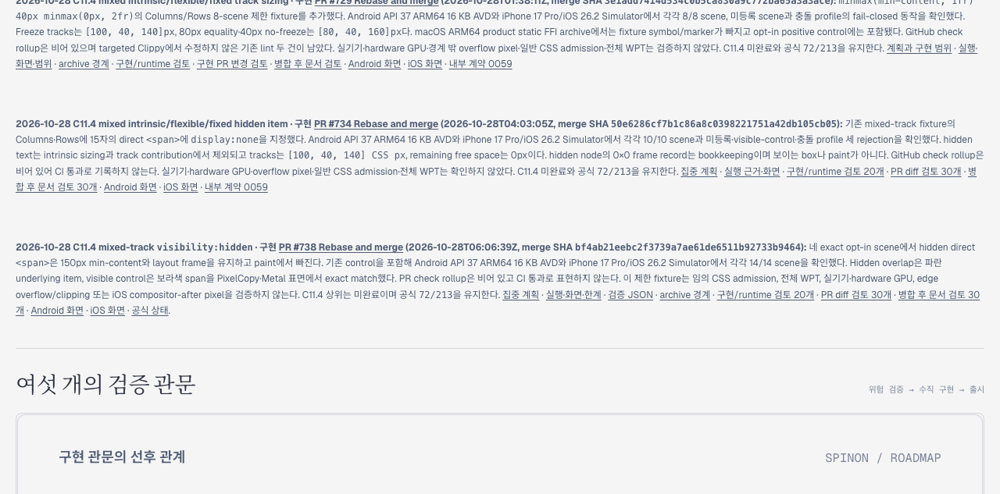

# PR #741 병합 후 Tailnet 로드맵 동기화

2026-10-28에 PR [#741](https://github.com/ohah/spinon/pull/741)을 병합한 뒤 Tailnet 미리보기에는 저장소의 `spec/public/roadmap.html`만 반영했다. 이전 동기화에서 이 파일만 복사된 상태였기 때문에 #738 카드의 새 링크는 같은 서버에서 404였다. 카드 링크를 GitHub 문서·JSON·고정 raw PNG 주소로 바꾸고 로드맵 파일을 갱신했다.

## 변경 대상과 백업

- 저장소 main commit: `974296be9744681b42ea9c79a512e183f2d836a2`
- 변경한 배포 경로: `/Users/yoonhb/Library/Application Support/SpinonPreview/roadmap.html`
- 변경하지 않은 별도 listener: PID `33319`, port `4174`
- 유지한 preview server: PID `28040`, port `8768`; 재시작하지 않았다.
- 교체 전 파일은 open handle 없는 regular file이었다. 같은 볼륨의 atomic replace를 사용했다.
- 바이트 단위 백업: `/Users/yoonhb/Library/Application Support/SpinonPreviewBackups/roadmap-tailnet-sync-pr741-2026-10-28/pass01/roadmap.html`
- 백업 SHA-256: `0adb06aff0f5c2733a02b20d18099ccad2c6093e060b164a4f8ccad612483ea6`

## 해시와 HTTP 결과

| 시점 | 바이트 | SHA-256 | 로컬 HTTP | Tailnet HTTP |
|---|---:|---|---:|---:|
| 교체 전 | 363,975 | `0adb06aff0f5c2733a02b20d18099ccad2c6093e060b164a4f8ccad612483ea6` | 200 | 200 |
| 교체 후 | 364,401 | `22d32405f27f7b67b51745e26c8d3a7d915b901a0556e3dac6c32a9e01217cba` | 200 | 200 |

교체 후 로컬 및 Tailnet 응답의 바이트 수와 SHA-256은 저장소 main의 원본과 일치했다. 응답은 `Cache-Control: no-cache`였다. Tailscale backend는 `Running`, self는 `Online`이었다. 자세한 사전 조건과 결과는 [preflight.json](./preflight.json) 및 [sync-result.json](./sync-result.json)에 기록했다.

## Agent Browser 확인

Agent Browser로 [live roadmap](https://macstudio.tailed42f2.ts.net/spinon/roadmap.html)을 열어 #738 카드를 화면에 표시했다. 카드 문서·근거·JSON·리뷰·PNG·공식 상태의 11개 링크는 전부 GitHub origin으로 향했고, 같은 Tailnet origin 링크는 0개였다. 대상 GitHub 문서 8개와 PR 페이지는 브라우저에서 열리는 것을 확인했다. 이미지 링크는 immutable merge SHA를 사용하며 Android PNG 1080×2400, iOS PNG 1206×2622가 로드됐다.

화면 파일은 1280×633 PNG이며 SHA-256은 `ff129fc17b9f80b4760851ff6600550e4d82af9d66c55aaaaae2e29b8dd76846`이다. 브라우저 세션을 닫고 활성 Agent Browser 세션이 없으며 관련 브라우저 프로세스도 남지 않은 것을 확인했다.

## 범위

이 작업은 문서 링크와 정적 미리보기 파일만 동기화했다. C11.4 상위 항목은 미완료이며 공식 완료 수 `72/213`은 바뀌지 않았다. runtime을 다시 실행하거나 앱 동작을 새로 검증한 것으로 보지 않는다.
