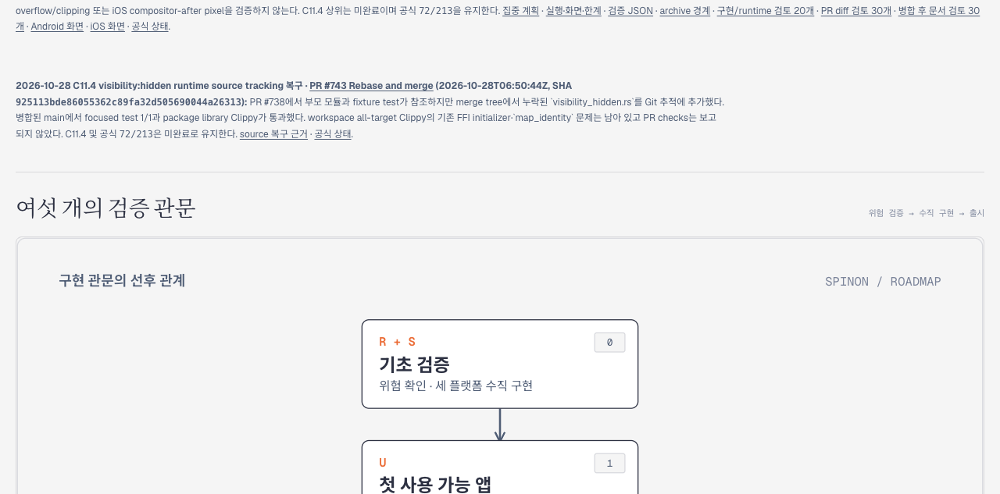

# PR #744 병합 후 Tailnet 로드맵 동기화

2026-10-28에 PR [#744](https://github.com/ohah/spinon/pull/744)을 병합한 뒤 `spec/public/roadmap.html`의 최신 source-tracking 기록을 Tailnet preview에 반영했다. C11.4는 미완료이며 공식 완료 수 `72/213`은 그대로다.

## 사전 확인과 백업

- 저장소 main commit: `15c253c67ae70ca37004f8c14c4f1b0d264828ae`
- source: `spec/public/roadmap.html`, 365,344 bytes, SHA-256 `e1ec9b89dacca1acc9a7a72d679a3f41b2dc7f42722646b2a1ef1f075c3ff316`
- 교체 전 server file: 364,401 bytes, SHA-256 `22d32405f27f7b67b51745e26c8d3a7d915b901a0556e3dac6c32a9e01217cba`
- server file은 regular file이고 교체 시 열린 handle이 없었다.
- 교체 전 백업: `/Users/yoonhb/Library/Application Support/SpinonPreviewBackups/roadmap-tailnet-sync-pr744-2026-10-28/pass01/roadmap.html`
- 백업 SHA-256은 교체 전 server file과 일치한다.
- 서버 file은 같은 디렉터리의 임시 파일 검증 후 atomic replace했다. 권한 mode는 `0644`다.

## 서버와 HTTP 결과

Tailscale backend는 `Running`, self는 `Online`이었다. 기존 preview listener PID `28040` / `127.0.0.1:8768`을 유지했고, 별도 listener PID `33319` / `127.0.0.1:4174`도 건드리지 않았다.

| 시점 | HTTP | 바이트 | SHA-256 |
| --- | ---: | ---: | --- |
| 교체 전 | 200 | 364,401 | `22d32405f27f7b67b51745e26c8d3a7d915b901a0556e3dac6c32a9e01217cba` |
| 교체 후 | 200 | 365,344 | `e1ec9b89dacca1acc9a7a72d679a3f41b2dc7f42722646b2a1ef1f075c3ff316` |

응답 `Content-Type`은 `text/html; charset=utf-8`, `Cache-Control`은 `no-cache`였다. Tailnet에서 내려받은 실제 본문 SHA-256도 저장소 source 및 교체된 server file과 일치한다.

## Agent Browser 확인

Agent Browser로 [Tailnet 로드맵](https://macstudio.tailed42f2.ts.net/spinon/roadmap.html?sync=pr744-15c253c6&capture=2)을 열었다. 새 source-tracking 카드가 보이고 공식 `72/213`, PR #743, 복구 근거 링크가 표시됐다. PR #743 페이지와 근거 README를 각각 열어 확인했다.

캡처는 1280×633 PNG이며 SHA-256은 `2b1e95a91e101f2ec9f75dfa50c5371fc4419c4a0172d09e0b65b07a4cd45ec0`이다. 브라우저 세션을 닫은 뒤 `agent-browser` 프로세스가 남지 않은 것을 확인했다. 전체 구조화 값은 [검증 JSON](./verification.json)에 있다.

## 범위

정적 roadmap 파일만 동기화했다. Tailscale/preview server를 재시작하지 않았고 앱이나 C11.4 runtime을 새로 실행하지 않았다.
