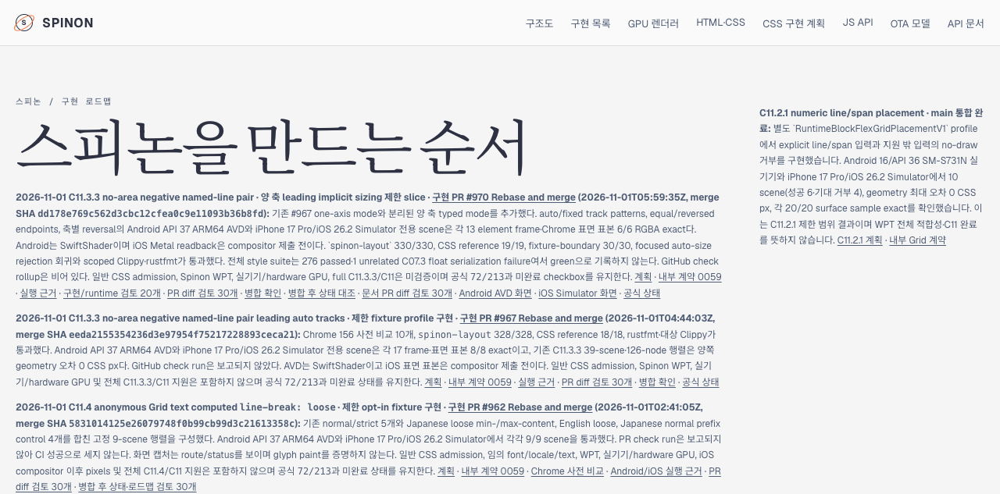

# PR #971 후 Tailnet roadmap 반영 · 2026-11-01

## 범위

PR [#971](https://github.com/ohah/spinon/pull/971) 병합본 `1a862af09ddf53d91043facfe744b24322536def`의 tracked 파일만 선택해 사용자 Tailnet 미리보기를 갱신했다. 작업 트리는 큰 미추적 evidence 집합을 포함했으므로 선택 manifest는 Git index 기준으로 만들었다. Tailscale backend는 `Running`이었고 기존 preview server PID `28040`이 `127.0.0.1:8768`에서 동작 중이었다.

## 게시와 일치 검사

- 선택된 root: 149 files / 4,774,651 bytes; 원본 roadmap `spec/public/roadmap.html`은 474,950 bytes, SHA-256 `14a4390e2573404a1a20a9a1962c8c66a08dac54ca551f0acf0e718c0b394155`.
- 게시물: 224 routes / 13,391,160 bytes. PR #970 merge SHA `dd178e769c562d3cbc12cfea0c9e11093b36b8fd`가 표시되고 공식 집계는 `72/213`, C11은 미완료다.
- Preview 대상은 새 파일 195개, 교체 11개, 동일 18개였다. 교체 전 파일 11개는 `~/Library/Application Support/SpinonPreviewBackups/roadmap-tailnet-sync-pr971-2026-11-01/pass01`에 보관했다. 삭제는 없었다.
- 224개 로컬 대상과 HTTPS route 모두 SHA-256 일치, HTTP 200을 확인했다. 11개 교체 백업도 원본과 일치했다. Preview server를 재시작하지 않았다.
- 선택된 roadmap 내부 링크 11개는 게시 route를 찾았다. 전체 문서 사이트 dead-link 검사는 수행하지 않았다.

원본 manifest와 요약 검증 결과: [선택 root](./selected-root.json), [publication manifest](./selected-publication.json), [roadmap route 검사](./selected-route-audit.json), [sync 요약](./sync-summary-pass01.json), [후속 문서 PR diff 검토 36개](./plan-sync-pr-diff-review-36.md). 로컬 host/IP 정보가 포함된 원시 preflight report는 이 저장소에 복사하지 않았다.

## Agent Browser 확인

`https://macstudio.tailed42f2.ts.net/spinon/roadmap.html`에서 roadmap 제목과 PR #970 C11.3.3 카드, merge SHA, `72/213`, “미완료” 문구를 확인했다. `/STATUS.html`에서도 `72/213`, C11 heading, merge SHA를 확인했다. 해당 PR 카드에서 연결된 Android 이미지(1080×2400)와 iOS 이미지(1206×2622)가 각각 열렸다.

검사 항목은 [Agent Browser 결과](./agent-browser-verification-pass01.json)에 기록했다. 세션 `spinon-tailnet-pr971`을 닫은 뒤 agent-browser와 Chrome 프로세스가 남지 않았다. 그때 확인한 프로세스 목록에는 기존 preview server만 남아 있었다([lifecycle 확인](./agent-browser-lifecycle-pass01.json)).

## 한계

이 확인은 PR #971 병합본의 공개 roadmap/상태 route와 링크된 두 simulator 이미지를 대상으로 한다. 전체 사이트의 모든 링크, 브라우저 외 클라이언트, 시뮬레이터가 아닌 실기기 동작을 검증하지 않는다. C11 구현 전체를 완료로 판정하지 않으며 공식 `72/213`도 바꾸지 않는다.
