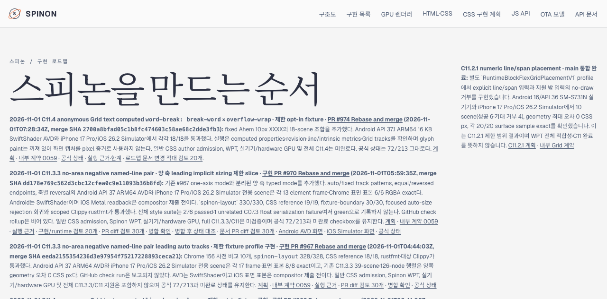
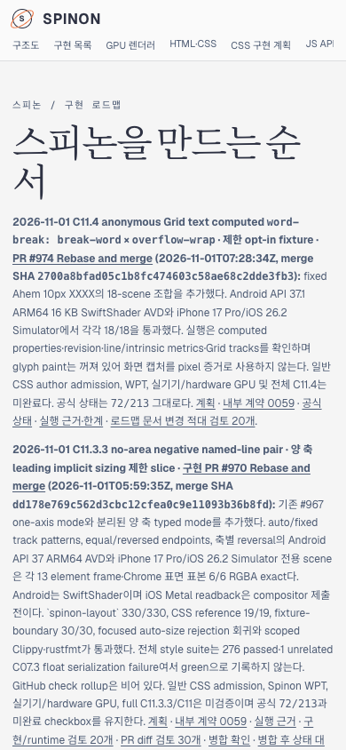

# PR #974 병합 후 C11.4 roadmap Tailnet 동기화 · 2026-11-01

## 범위와 build

PR [#974](https://github.com/ohah/spinon/pull/974)의 병합 commit `2700a8bfad05c1b8fc474603c58ae68c2dde3fb3`을 기록한 문서를 선택 build해 기존 Tailnet 미리보기에 반영했다. 작업 checkout은 일반 branch `docs/c11-4-word-break-break-word-post-merge`였고 worktree를 만들지 않았다. 기존 미추적 산출물은 수정·삭제·일괄 stage하지 않았다.

lockfile의 Rspress 2.0.22로 Git 추적 파일만 복사한 선택 root를 build했다. Build config는 해당 root만 대상으로 하며 dead-link/dead-image 검사 전체 사이트 검증을 끈다. final route manifest는 각 route/hash와 roadmap 카드의 다섯 local 링크 검증을 기록한다. 전체 문서 사이트 모든 링크를 증명하지 않는다. JSON manifest와 실행 script는 이 PR의 같은 evidence directory에 포함했다.

## Tailnet 반영과 무결성

Tailscale backend는 `Running`이었다. 기존 preview server PID 28040은 이미 실행 중이었고 재시작하지 않았다. Preflight에서 local roadmap HTTP 200, 교체 대상의 열린 file handle 부재와 목적지 symlink 부재를 확인했다. final copy는 변경 파일을 개별 backup 후 atomic rename했고, 삭제하지 않았다. 정확한 route 수와 각 local/HTTPS SHA-256은 PR에 첨부된 JSON evidence reports에 남겼다.

기존 server가 `spec/plan/c11-css-grid.html`을 열어 둔 상태라 이 route는 건드리지 않았다. 짝이 되는 raw source alias `spec/plan/c11-css-grid.md`도 선택 카드/계획에서 사용하지 않아 게시 대상에서 제외했다. 새 카드가 연결하는 `/plan/c11-css-grid.html` 경로는 build·게시·검증에 포함했다. 열린 파일을 닫기 위해 기존 preview server를 종료하거나 재시작하지 않았다.

## Agent Browser 확인

Agent Browser에서 PR #974 카드의 merge SHA, 공식 `72/213`, 다섯 링크를 읽었다. 390×844 viewport에서 카드가 보이고 document width가 390px여서 가로 넘침이 없다. 공식 상태 route에서 C11과 C11.4는 unchecked로 표시된다. 새 review route에는 서로 다른 20개 관점이 모두 PASS로 렌더링된다.

기계 판독 결과와 Browser lifecycle report도 evidence directory에 있다. `agent-browser close --all` 뒤 Agent Browser/해당 Chrome process가 남지 않았고 기존 preview server PID 28040은 계속 실행 중이었다.

## 문서 변경 검토와 한계

[문서·Tailnet PR diff 적대 검토 20개](./roadmap-pr-diff-review-20.md)를 별도로 기록했다. 검증은 제한 opt-in simulator slice와 새 roadmap 카드의 선택 route만 다룬다. Glyph pixels, 일반 CSS admission, WPT, 실기기/hardware GPU 또는 전체 C11.4/C11을 완료로 판정하지 않는다. 공식 완료는 `72/213` 그대로다.
