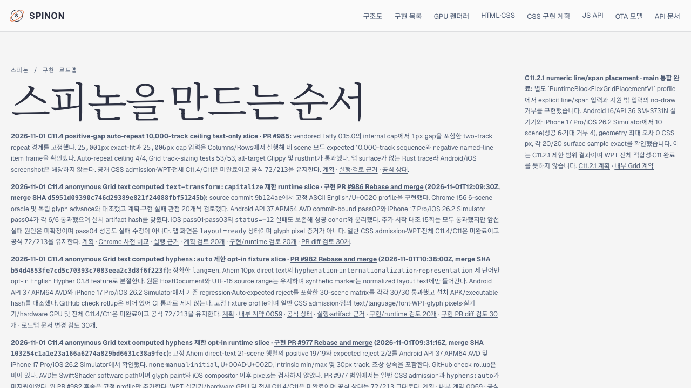
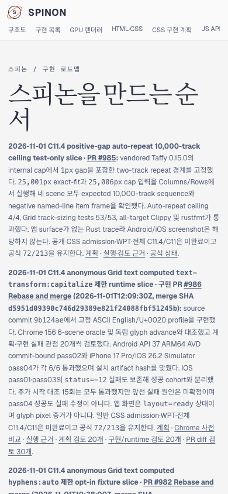

# PR #986 C11.4 로드맵 Tailnet 미리보기 동기화

2026-11-01에 병합 PR #986의 C11.4 제한 `text-transform:capitalize` slice와 merge SHA `d5951d09390c746d29389e821f24088fbf51245b`를 공식 상태 대장 및 공개 roadmap에 반영한 PR #987 내용을 Tailnet 미리보기에 동기화했다. 기준 source HEAD는 PR #987 merge commit `0f8d7d708d10d25e92391cb50adc0cd9204d5945`다. C11/C11.4는 계속 미완료이며 공식 완료는 `72/213`이다.

## 빌드·게시 범위

- RSPress 2.0.22의 선택 문서 build가 통과했다. 선택 root는 이전 Tailnet publication 795개 파일에 상태 대장, roadmap, 내부 계약 0059, C11/C11.4 계획, `capitalize` oracle/runtime 근거와 검토를 overlay해 909개 파일로 구성했다. 전체 문서의 dead-link/dead-image 검사는 꺼져 있어 전체 사이트 링크 통과를 뜻하지 않는다.
- 이전 publication 931개 route를 보존하고 새 1,133-route publication을 만들었다. 동기화 manifest는 202개 추가, 261개 변경, 삭제 0개를 기록한다.
- Preflight에서 Tailscale backend `Running`, 기존 preview server PID 28040, local roadmap HTTP 200, 수정 대상 open handle 0개를 확인했다. 서버는 재시작하지 않았다.
- 원자적 교체로 200개 route를 추가하고 61개를 변경했으며 동일한 872개 route는 유지했다. 변경 전 61개 파일의 backup을 `/Users/yoonhb/Library/Application Support/SpinonPreviewBackups/roadmap-tailnet-sync-pr987-2026-11-01/pass02`에 보존했다.
- 동기화 후 1,133/1,133 route의 로컬 hash를 확인했고, 백업 61/61도 기존 hash와 일치했다. 로드맵·상태·계획·계약·oracle/runtime 페이지와 화면 등 필수 17 route는 local HTTP 및 Tailnet HTTPS에서 모두 200과 SHA-256 일치였다. Route-set SHA-256은 `416d1cd7d07aa6127ac961c147015581149827564bc7cff23dd42b024bf14018`이다.

## Agent Browser 화면 확인

Agent Browser에서 Tailnet 로드맵의 PR #986 merge 카드, merge SHA, 공식 `72/213`을 확인하고 데스크톱과 모바일 화면을 저장했다. Mobile viewport에서 `documentElement.scrollWidth`와 `body.scrollWidth`는 모두 390px이다. 상태 페이지에서도 C11과 C11.4는 미완료, C11.2.2와 C11.2.3은 완료로 표시된다.

확인 뒤 `agent-browser close --all`을 실행했다. Agent Browser session은 inactive이며 executable process는 남지 않았다. Tailnet preview server PID 28040은 계속 실행 중이다.

## 보존한 게시 준비 실패

첫 `stage-publication` 시도는 HTML anchor가 `PR`과 `#986`을 서로 다른 text node로 나누는 점을 반영하지 못한 marker 검사에서 실패했다. 실패 보고서와 partial output은 보존했다. 이 실패는 preview copy 전에 발생했으며 server나 preview 파일은 변경하지 않았다. pass02에서는 card의 `#986 Rebase and merge` text와 local link route를 검사한 뒤 정상 완료했다. 전체 route/hash 보고서는 `selected-publication-pass02.json`, `preflight-pass02.json`, `copy-and-backup-pass02.json`, `served-verification-pass02.json`에 있다.

`SHA256SUMS.txt`에는 이 evidence directory의 스크립트, JSON 보고서, build 결과 요약, 화면 캡처 및 검토 문서 hash가 기록되어 있다. RSPress가 출력한 전체 자산 표는 열 padding 공백 때문에 raw log를 로컬 workspace에 보존하고, commit에는 성공 상태 여섯 줄만 담은 `selected-build-pass02-summary.log`를 포함했다.
