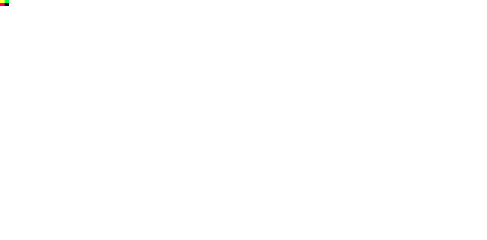

# U05.1 PNG 사전 비교 · 2026-10-14

## 입력과 실행

- Fixture: [`c14-1-png-basic.png`](../../../../tests/fixtures/resources/c14-1-png-basic.png), 97 bytes.
- SHA-256: `5d8c9509a0fec2288f02611a8ccc22a23a90033d1a96b894b439525398bce4a2`.
- Page: [`c14-1-png-basic.html`](../../../../tests/fixtures/resources/c14-1-png-basic.html).
- Tool: `agent-browser`, scoped worktree session `spinon-u05-5e54e25246d4`; local file page. Terminal browser was not used.
- Browser user agent: `Mozilla/5.0 (Macintosh; Intel Mac OS X 10_15_7) AppleWebKit/537.36 (KHTML, like Gecko) HeadlessChrome/155.0.0.0 Safari/537.36`.
- `navigator.userAgentData.getHighEntropyValues(["fullVersion"])` did not return a full version in headless mode. Evidence therefore pins major version and full UA, not an invented patch version.
- `devicePixelRatio=1`, `img.complete=true`, `naturalWidth=24`, `naturalHeight=16`, rect `{x:0,y:0,width:24,height:16}`.

## 판정 기준

PNG decoder must return dimensions `24×16`, 1536 bytes RGBA8, and an image-resource measurement that reaches the C14.1 layout adapter as `24×16 CSS px`. The layout comparison allows an absolute error of `0.5 CSS px` per frame field. This observation covers one static, untagged sRGB-default PNG at DPR 1 only; it is not full PNG conformance, color-management, mobile-runtime, or GPU-surface evidence.

## Screenshot

